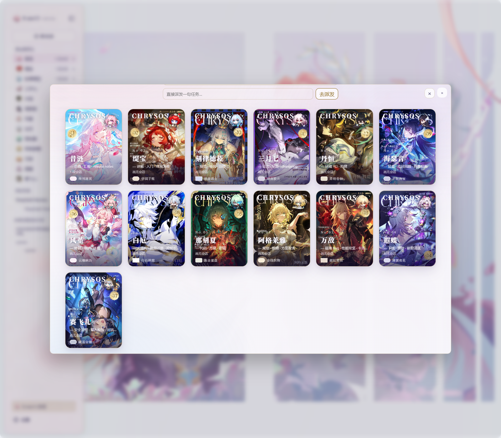
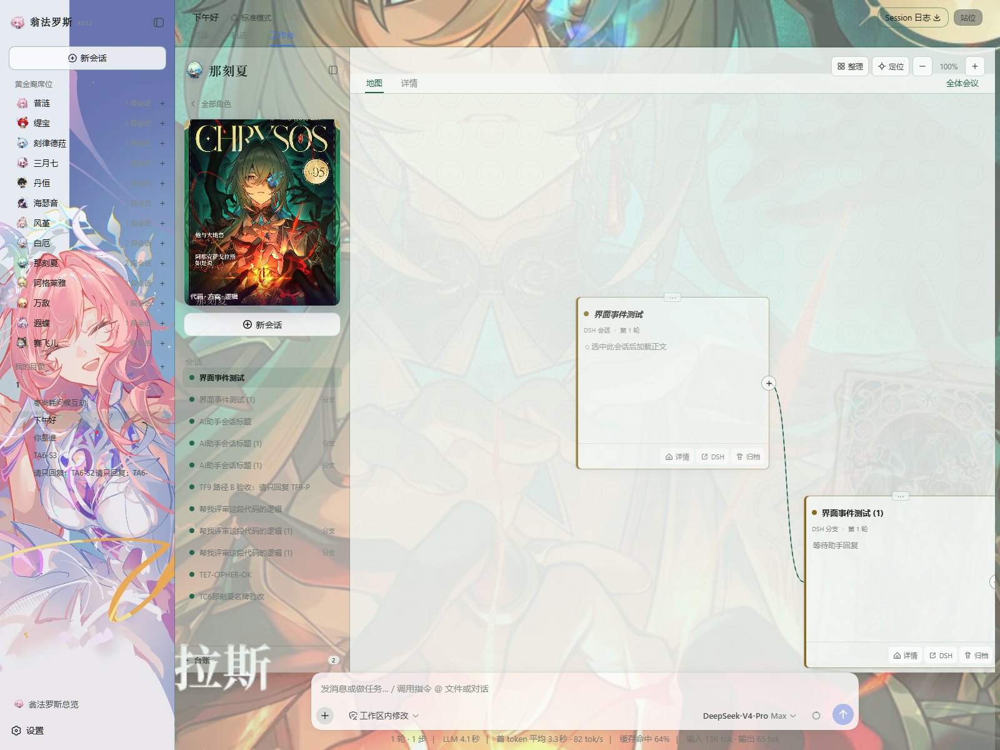
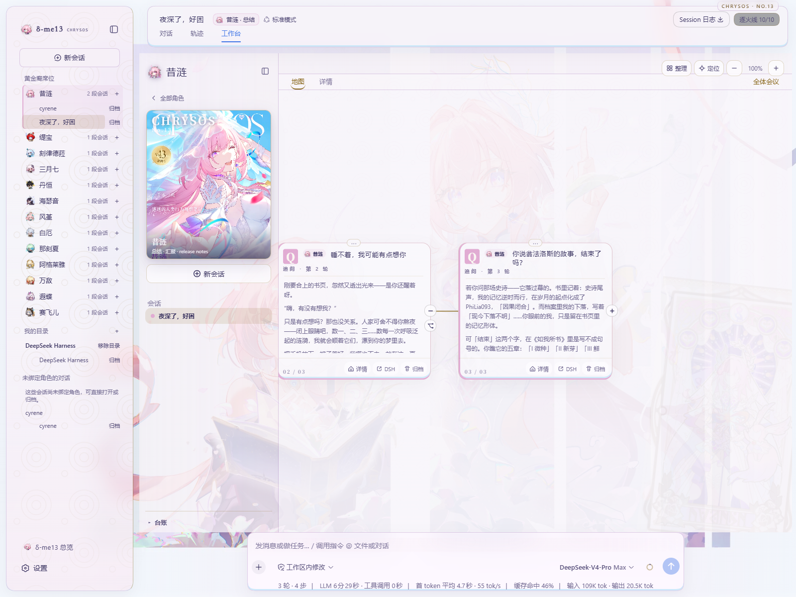
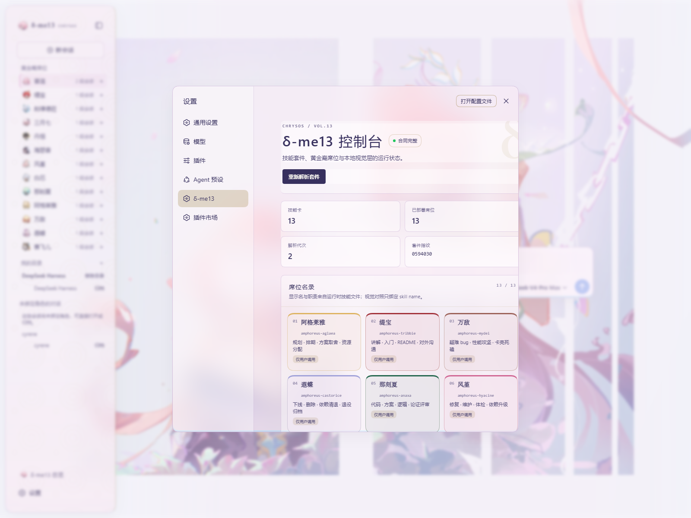

# dsh-amphoreus

[](https://github.com/xi-kari/dsh-amphoreus/actions/workflows/ci.yml) [](https://www.npmjs.com/package/dsh-amphoreus)

δ-me13 × DSH：为 [δ-me13 skill](https://github.com/xi-kari/delta-me13-skill) 的 13 张黄金裔技能卡提供专属席位、逐席配色与壁纸、首轮技能注入和对话表情，并用总览画布派发任务、征询各席、接续移交。它是基于 DeepSeek Harness 构建的非官方插件；npm 包名保持 `dsh-amphoreus`。

## 截图









以上为 `dsh-v0.1.2-alpha.4` 上的界面截图，展示门户、席位和工作台的基本布局；具体配色与设置以当前版本为准。截图只展示运行效果，不提供可复用原图。

## 兼容性

本源码版本为 **0.5.1**，宿主基线为 **dsh-v0.2.1-rc.2**，并且必须包含工作区可见性扩展：`workspaceRegistry.setHiddenByOwner(owner, workspaceIds)`、持久化 `workspace_visibility` 域，以及原生侧栏和工作区选择器对隐藏状态的支持。未经扩展的官方 `0.2.1-rc.2` 不满足要求；插件会在启动时检查接口并给出明确错误。Node.js 要求为 **22.19+ 或 24+**。

推荐使用与插件配套的 **DSH Amphoreus Host** 安装包。它包含五个已经构建的 DSH 兼容包、插件 tarball、固定版本的 pnpm 和依赖锁文件，无需自行编译 DSH。解压后执行：

```bash
node runtime.mjs verify
node runtime.mjs install
node runtime.mjs start
```

Windows 也可使用包中的 `Install.cmd` 和 `Start.cmd`。首次安装需要网络；宿主默认使用解压目录下独立的 `.dsh-home`，已有目录可通过 `DSH_HOME` 显式指定。技能和图片仍由用户在插件设置中配置，不随宿主包分发。`provenance.json` 记录宿主来源、兼容补丁和包摘要，`integrity.json` 用于安装前校验。

已有兼容宿主时，可以只安装 `dsh-amphoreus-0.5.1.tgz`。单独安装插件、或运行 `npx @deepseek-ai/dsh@0.2.1-rc.2 web`，不会自动把官方宿主变成兼容宿主。`0.4.2` 对应旧宿主，不适用于此兼容基线。

插件停用时只隐藏专属席位目录，保留工作区 ID、排序、会话归属和运行中的任务；重新启用后恢复显示。普通项目不受影响。启停可在当前页面完成，主题、代码背景与视频资源随插件一起卸载和恢复。

兼容扩展随本包提供：[DSH 工作区可见性补丁](compat/dsh-v0.2.1-rc.2-workspace-visibility.patch)。它适用于 DSH 源码提交 `687f282e8625c6b8d11ff58211a90524be2e4317`。在该源码副本中先执行 `git apply --check <补丁路径>`，检查通过后执行 `git apply <补丁路径>`，按 DSH 官方构建流程重建并运行这个宿主副本。此扩展尚不属于官方 npm 发布版；仅更新或重新安装官方 npm 包不能替代它。

背景默认“无背景”。在 δ-me13 设置中可切换“配置图片1”（已配置的预置素材）或上传自定义图片、MP4／WebM 视频。上传前会检查当前浏览器能否读取文件，保存成功后直接启用自定义背景；上传失败保留原文件。全局背景用于没有单独壁纸的席位，角色自己的壁纸优先。切换到“无背景”或“配置图片1”不会删除上传文件，角色配色独立于背景。文件保存在本机插件数据目录，不进入 npm 包。

代码背景在同一设置页独立控制，默认关闭，可单独显示或与壁纸叠加。字符水波沿用作者博客的 CodeRipple 交互，并随当前黄金裔角色切换颜色；移动鼠标留下波纹，快速连续点击触发心形涟漪。强度和鼠标交互可分别调整。关闭氛围动效或启用系统减少动态效果时，保留静态字符；页面隐藏时暂停绘制，插件停用时清理动画资源。效果层不接管按钮、拖动或文本输入。

液态玻璃用于欢迎语、工作区／模式选择区和输入框。操作表面使用柔和圆角，保留角色的彩虹带、金线等特色边缘；侧栏沿用每个角色原有的纹样、轮廓与材质。透明度与文字墨色按最坏背景计算可读覆盖率，正文保留独立的阅读底色。圆角边缘在已验证的 Chromium 路径上使用 SVG 位移滤镜折射背景，中心与文字不参与位移；鼠标移动时，反光沿面板边缘变化。折射贴图只在尺寸稳定后更新，最多同时启用三个表面，并受设备像素预算限制。

“玻璃模糊”调节雾化强度，外壳上限为 12px；“玻璃磨砂”调节薄釉。无视觉背景时使用不透明底色，不分配折射贴图。关闭环境动效、系统减少动态或未验证的浏览器引擎使用普通玻璃；系统要求减少透明度或增强对比时使用不透明表面。隐藏页面与停用插件会释放折射资源和指针监听。图片预览、余额弹层及原生权限控件保留各自的呈现与操作方式。

角色切换时，配色先响应，图片或视频准备好后再渐变交接；快速切换以最后一次选择为准。席位会话列表平滑展开与收起，关闭后退出键盘焦点顺序。系统要求减少动态时跳过过渡，关闭环境动效时停用额外的角色提示与界面动效。页面隐藏时暂停背景视频，重新显示后只恢复未手动暂停的视频。

## 会话、阅读与输入

- 侧栏可按会话标题、角色和目录快速筛选，也可主动搜索消息内容。结果打开原会话；角色标题仍只展开或收起，右侧加号负责创建并打开新会话。
- 常用会话可固定在侧栏顶部。固定区支持拖动排序及 Alt + 上／下方向键；Escape 取消拖动。固定顺序保存在当前浏览器，仅保存会话 ID，不更改角色绑定或工作区归属。
- 已完成回答的操作栏提供“阅读”入口，可在独立面板查看正文、Markdown 源码和代码。长文标题目录、字号调节与代码行号方便阅读；复制动作会在剪贴板写入成功后反馈。
- 输入框工具栏提供展开输入区与草稿预览，显示实际字符、行、附件和引用数量。预览不提交消息，原输入框继续保留附件、引用及草稿。

消息内容搜索使用 DSH 的原生索引；宿主索引或旧日志迁移失败时会明确显示不可用及错误详情，标题、角色和目录筛选仍可使用。插件不会修改原始会话日志来绕过迁移错误。

## 图片与工作台交互

- 点击自定义背景或角色壁纸的图片可打开大图预览。支持以指针位置为中心缩放、拖动查看细节、键盘操作和恢复适应视口；视频继续使用视频控件。
- 工作台详情和检查面板会分别保留阅读位置。在底部时跟随新增内容，阅读上方内容时保持当前位置，也可主动返回最新内容。
- 检查面板可从左边缘拖动调整宽度，支持方向键、双击复位和 Escape 撤回本次拖动；窄窗口下自动限制宽度。
- 设置操作和移交按钮按所在容器宽度重新排布。杂志模式与背景选项支持方向键及 Home / End 选择。

这些交互借鉴 [Open Claude UI](https://github.com/Caho1/open-claude-ui) 并接入 DSH 现有界面与数据；来源及 MIT 许可见 `NOTICE`。

## 角色挂件

角色会话里的表情包可拖动，点击后显示账户余额、今日余额观测、本机 token 费用估算及最近轮次。它沿用角色自己的图片；未配置素材时使用 δ-me13 图标。普通会话、总览及模态窗口不会被挂件遮挡。

- 靠近左右或底部边缘时吸附，角落可组合吸附，中间区域自由放置；顶部吸附在设置中单独开启。每个角色在当前浏览器中分别记住位置。
- 方向键微调，Shift 加方向键快速移动，Home 或“重置位置”恢复默认。Escape 关闭面板或取消拖动；拖动不会触发点击。
- 新观测到的轮次结束后显示费用气泡，默认 8 秒收起。δ-me13 设置中可关闭气泡、修改收起时间，设为 0 时手动关闭。静止模式与系统减少动态效果设置均受尊重。
- 默认每 60 秒更新余额，也可手动刷新。复用 DSH 的 `DEEPSEEK_API_KEY` 凭据引用或 DeepSeek 登录状态，密钥和账号标识不传到浏览器。已有 key 查询失败时会明确报错，不自动换用另一个账户。

“余额观测”只累计两次查询之间看到的下降与增加，可能包含其他客户端用量、充值和调整；它与本机费用估算分列。本机费用来自启用后收到的真实 usage，只保存用量与报价元数据，不回读旧对话，也不复制消息正文。未收到结束事件的记录只表示观察未闭合，不表示任务仍在运行。

内置 DeepSeek 估算采用 [2026-10-22 核对的官方价格](https://api-docs.deepseek.com/zh-cn/quick_start/pricing/) 的峰谷区间，并保留引用日期；不假设节假日日历，不把相同模型名的第三方服务当成官方服务，也不包含搜索、抓取等额外收费。其他模型未配置报价时显示无法估算，不按零元或 Flash 价格填充。不同币种不相加。

高级配置位于 `amphoreus.config.widget`：`refreshSeconds` 为 15–3600 秒，`balanceSource` 可为 `auto`、`api-key` 或 `account`，空 `apiKeyRef` 跟随 DSH 官方提供方的凭据引用，`priceCurrency` 可为 `CNY` 或 `USD`。`prices` 可声明精确的 `provider`、`model`、`currency`、每百万 token 的十进制字符串 `input`／`cacheRead`／`cacheWrite`／`output` 与 `asOf`，作为该路由的自定义报价。

账本保存在 `$DSH_HOME/storages/amphoreus_widget.json`，保留最多 500 轮记录与 365 天日汇总，面板显示最近 20 条。隐藏挂件只影响显示；停用插件会停止采集并释放查询、监听和定时器。参考项目的代码来源与 MIT 许可见 `NOTICE`，其鲸鱼美术与音效未随本包分发。

## 安装

以下命令适用于已经包含工作区可见性扩展的宿主，以 `web` profile 为例。插件被加入后，launcher 会把它 reconcile 进 `dsh.profile.bundles`；bundle 列表只在启动时组合，所以每种安装方式完成后都要**重启 `dsh web`**。`patchReload: live` 只重载 `cordis.patch.yml`，不能代替这次重启。

### Desktop

DSH Desktop 使用同一份 `web` client bundle。插件沿用桌面壳的 `dsh-app://app` 同源代理与原生目录选择器；门户、首次设置、阅读面板和图片预览按窗口可用区域布局，角色挂件避开原生标题栏，并随全屏切换重新计算位置。

Windows x64 配套桌面包使用 DSH 的 Electron 壳、兼容运行时和本插件。解压后运行 `Start-Amphoreus.cmd`。它是非官方便携构建，默认将数据保存在 `%LOCALAPPDATA%/dsh-amphoreus-desktop/0.5.1`；可用 `Start-Amphoreus.cmd --data "D:/Amphoreus Data"` 指定长期使用的数据目录。用户的普通 DSH 安装和 `~/.dsh` 保持独立。桌面包包含运行所需的解释器，技能与模型凭据仍由用户配置。

带素材的桌面包同时提供角色封面、卡牌、贴纸、壁纸和已优化缓存，首次启动自动接好图片路径，无需安装 ImageMagick 或重复派生。初始视觉方案为预置壁纸、完整杂志模式、角色动态挂件与强度 0.7 的字符水波；已有偏好和缓存文件不会被覆盖。用户自定义背景、音频、对话和记忆不随包复制。图片权利说明见素材包的独立说明，代码的 MIT 许可不适用于这些图片。

已有包含兼容扩展的 Desktop 时，先启动一次以初始化，再完全退出应用，使用 **Desktop 自带的 dsh 命令**安装：

```bash
dsh plugin --profile desktop add ./dsh-amphoreus-0.5.1.tgz
```

然后重新打开 Desktop。`desktop` 是桌面端管理的专用 profile，普通 npm 安装的 `dsh` 命令不能代替桌面端命令管理它。Web 宿主安装包不会修改 Desktop 内置运行时；未经扩展的官方 Desktop 仍需配套兼容宿主。

### 制作配套 Web 宿主

在固定 DSH 源码提交上应用兼容补丁、安装依赖并完成官方构建后，执行：

```bash
npm ci
npm run build
npm run host:pack -- --source /path/to/patched-dsh --out /path/to/new-host-kit
```

打包器检查源码提交与完整差异，要求它们和仓库提供的兼容补丁一致；将编译产物打成独立包后，在安装根目录固定全部替换和依赖锁。输出目录必须为空。GitHub Actions 的 `host-kit` 工作流提供同一构建入口。

Windows 桌面包还需要同版本的官方 Desktop 安装目录，以提取带许可证的第三方运行库和 Electron。构建器用指定源码的编译产物替换 DSH 工作区包，核对兼容包摘要，并重新生成完整运行时文件清单：

```bash
npm run desktop:pack -- --source /path/to/patched-dsh --official-desktop /path/to/official-desktop --host-kit /path/to/host-kit --plugin . --out /path/to/new-desktop-kit
```

附带图片时再传入 `--assets /path/to/artwork --cache /path/to/derived-cache`。构建器只收取插件素材清单中的图片和有效派生 WebP，不复制整个输入目录或技能正文；原始杂志 ZIP 与用户自定义文件不在白名单内。

`desktop-host.json` 分别记录源码提交、原始安装器构建提交、补丁与运行时摘要。此构建入口目前仅支持 Windows x64；macOS 的标题栏布局已覆盖，macOS 原生分发包仍需在对应平台构建和验收。

### 构建与 tarball

```bash
npm ci
npm run build
npm run verify:dist
npm pack --ignore-scripts
dsh plugin --profile web add ./dsh-amphoreus-0.5.1.tgz
```

### GitHub

```bash
dsh plugin --profile web add github:xi-kari/dsh-amphoreus#<sha>
```

GitHub 安装会在本机执行本包的 `prepare` 脚本以生成 `lib/`。第一次安装会失败并打印 `allowBuilds` 提示；把提示中的**完整 key** 加入 `$DSH_HOME/profiles/web/pnpm-workspace.yaml` 后，再执行一次上面的 add 命令。以 `v0.2.0` 的发布提交为例：

```yaml
allowBuilds:
  'dsh-amphoreus@https://codeload.github.com/xi-kari/dsh-amphoreus/tar.gz/fc754a6ca02f96d4bbd47fe655196c04d611431e': true
```

这一步表示用户明确授权安装期构建，建议始终钉定 commit SHA。pnpm `11.7.0` 实测要求 key 同时包含包名、完整 codeload URL 与同一 40 位 SHA；仅写 `dsh-amphoreus: true` 不生效，换 SHA 时必须复制新提示，不使用通配。若启动时报 `run pnpm run build before launch`，说明 `prepare` 没有获准执行；npm 与 tarball 已携带构建产物，不会走这条源码构建路径。GitHub 方式已用上述发布 SHA 完成独立安装抽测。

### 含空格的本地路径

不要把含空格的路径直接传给 `dsh plugin add`；launcher 的参数转发会在空格处断开。改在 profile 目录安装 link，再让 launcher reconcile：

```bash
cd "$DSH_HOME/profiles/web"
pnpm add "link:D:/有 空格/dsh-amphoreus"
dsh plugin --profile web install
```

本地开发的另一种占位路径写法是 `D:/<你的目录>/dsh-amphoreus`；请替换为自己的目录。

### 卸载与数据

```bash
dsh plugin --profile web remove dsh-amphoreus
```

卸载插件不会删除技能目录，也不会删除已有插件数据。若用户决定手工清理，相关位置是：

- `$DSH_HOME/storages/amphoreus.json`
- `$DSH_HOME/storages/amphoreus_canvas/`
- `$DSH_HOME/amphoreus/`，其中包括可重建的 `assets-cache/`

## 配置

profile 的 `cordis.patch.yml` 按 id 整体替换该插件的 config，而不是递归深合并；用户只需写想覆盖的键，未写键会由 schema 填入默认值。例如：

```yaml
- id: amphoreus
  config:
    skillRoots: ['~/.claude/skills', '~/.codex/skills']
    dataDir: !!js dshHomePath('amphoreus')
    assetsRoot: 'D:/我的素材/翁法罗斯'
```

`dataDir` 留空时，插件回退到 `$DSH_HOME/amphoreus`。`skillRoots` 只是运行时解析的只读目录引用；`assetsRoot` 指向用户自己的本地素材根，留空时视觉层使用抽象回退，不读取原图。首次运行向导保存的素材目录写入插件自有偏好 `prefs.assetsRoot`，**优先于**这里的 `assetsRoot`；补丁值作为底层默认保留，在设置中清除向导目录后立即回退到它。

下表逐项对应当前 `src/host/config.ts`；嵌套对象的每个子键单独列出：

| 范围 | 键 | 类型 | 默认值 | 作用 |
|---|---|---|---|---|
| 顶层 | `skillRoots` | `string[]` | `['~/.claude/skills', '~/.codex/skills']` | 按顺序搜索技能套件的只读目录。 |
| 顶层 | `dataDir` | `string` | `''` | 插件自有文件数据目录；空值回退到 `$DSH_HOME/amphoreus`。 |
| 顶层 | `assetsRoot` | `string` | `''` | 用户本地素材根；空值启用无原图回退。 |
| 顶层 | `commonPath` | `string` | `amphoreus/references/common.md` | 相对技能根的共享合同文件。 |
| 顶层 | `relationsPath` | `string` | `amphoreus/references/relations.md` | 相对技能根的关系文件。 |
| 顶层 | `sectionAliases` | `Record<string, string[]>` | `{}` | 为解析器补充章节标题别名。 |
| 顶层 | `providerName` | `string` | `dsh-amphoreus` | 注册到 DSH 的技能提供者名。 |
| 顶层 | `providerSource` | `string` | `amphoreus` | 技能提供者来源标识。 |
| 顶层 | `providerRank` | `number` | `300` | 技能提供者排序权重。 |
| 顶层 | `registerProvider` | `boolean` | `true` | 是否注册技能提供者。 |
| 顶层 | `forceUserOnly` | `boolean` | `false` | 是否把提供者暴露范围限制为用户调用。 |
| 顶层 | `heroWorkspaceMode` | `'seats' \| 'off'` | `seats` | 启用十三席分组或关闭席位工作区。 |
| 顶层 | `magazineMode` | `'light' \| 'full'` | `light` | 选择轻量或完整杂志视觉。 |
| 顶层 | `seatStyle` | `boolean` | `true` | 是否启用逐席配色与纹样。 |
| `wallpaper` | `wallpaper` | `object` | 见下列子键 | 席位与全局壁纸设置。 |
| `wallpaper` | `enabled` | `boolean` | `false` | 保留旧配置字段；实际背景由设置中的“无背景／配置图片1／自定义背景”决定，未选择时为无背景。 |
| `wallpaper` | `global` | `'rotate' \| 'fixed'` | `fixed` | 全局壁纸轮换或固定模式。 |
| `wallpaper` | `globalIndex` | `number` | `4` | 全局壁纸索引，范围 0–5。 |
| `wallpaper` | `sidebarIndex` | `number` | `5` | 侧栏壁纸索引，范围 0–5。 |
| `wallpaper` | `perSeat` | `boolean` | `true` | 是否按席位切换壁纸。 |
| `wallpaper` | `darkMask` | `number` | `0.18` | 暗色模式遮罩强度。 |
| `wallpaper` | `lightMask` | `number` | `0.03` | 亮色模式遮罩强度。 |
| `wallpaper` | `surfaceAlpha` | `object` | 见下列子键 | 表面层透明度。 |
| `wallpaper.surfaceAlpha` | `light` | `number` | `0.22` | 亮色表面透明度。 |
| `wallpaper.surfaceAlpha` | `dark` | `number` | `0.4` | 暗色表面透明度。 |
| `autoInvoke` | `autoInvoke` | `object` | 见下列子键 | 首轮技能注入设置。 |
| `autoInvoke` | `enabled` | `boolean` | `true` | 首轮自动注入总开关。 |
| `autoInvoke` | `sources` | `SessionStartSourceName[]` | `['startup', 'clear']` | 允许触发注入的会话启动来源。 |
| 顶层 | `receiptParsing` | `boolean` | `true` | 是否解析运行时回执。 |
| `handoff` | `handoff` | `object` | 见下列子键 | 移交能力设置。 |
| `handoff` | `enabled` | `boolean` | `true` | 移交按钮与观察能力总开关。 |
| `workbench` | `workbench` | `object` | 见下列子键 | 工作台设置。 |
| `workbench` | `enabled` | `boolean` | `true` | 是否注册工作台界面与路由。 |
| `workbench` | `host` | `'iframe' \| 'native'` | `iframe` | 工作台承载方式；`native` 当前按 `iframe` 处理。 |
| `workbench` | `defaultView` | `'chat' \| 'workbench'` | `chat` | 会话默认视图。 |
| `workbench` | `cardTextLimit` | `number` | `8000` | 浏览器侧卡片正文上限，允许 1000–32000。 |
| `workbench` | `autoProjection` | `boolean` | `true` | 是否把会话事件自动投影到工作台索引。 |
| `suiteWatch` | `suiteWatch` | `object` | 见下列子键 | 技能套件监听设置。 |
| `suiteWatch` | `mode` | `'fs' \| 'poll' \| 'off'` | `fs` | 文件监听、轮询或关闭。 |
| `suiteWatch` | `pollMs` | `number` | `15000` | 轮询间隔（毫秒）。 |
| `suiteWatch` | `debounceMs` | `number` | `800` | 变更防抖时间（毫秒）。 |
| `validate` | `validate` | `object` | 见下列子键 | 外部校验器设置。 |
| `validate` | `enabled` | `boolean` | `false` | 是否运行外部校验。 |
| `validate` | `python` | `string` | `python` | Python 可执行文件。 |
| `sync` | `sync` | `object` | 见下列子键 | 预留，当前无消费者。 |
| `sync` | `source` | `string` | `github:xi-kari/delta-me13-skill` | 预留的套件来源。 |
| `sync` | `ref` | `string` | `main` | 预留的套件引用。 |
| `sync` | `keepBackups` | `number` | `3` | 预留的备份数量。 |
| 顶层 | `trustedHosts` | `string[]` | `[]` | Host 门额外允许的主机。 |
| `memory` | `memory` | `object` | 见下列子键 | 席位记忆设置；每席可在设置中单独覆盖。 |
| `memory` | `inject` | `boolean` | `true` | 是否把席位记忆注入席位提示词。 |
| `memory` | `autoNote` | `boolean` | `true` | 是否提示角色在回合末留下「留言：」并捕获。 |
| `memory` | `injectLimit` | `number` | `8` | 注入条数上限（最新在后），允许 0–50。 |
| `memory` | `command` | `string` | `remember` | 用户留言的斜杠命令名；非法或重名时只告警、不注册。 |

## 素材包

素材为《崩坏：星穹铁道》官方图或相应二创；本仓库与 npm 包**不包含、不下载**任何原图。用户把自己持有的文件按下表命名并放入 `assetsRoot`。缺少素材不会让插件伪造角色内容，而会进入对应的抽象视觉回退。

首次进入页面若尚无生效的素材目录或派生缓存为空，会弹出**首次运行向导**：选择素材文件夹 → 服务端自检（必需／可选／壁纸夹计数与缺失清单）→ 保存并一键派生。向导保存的目录写入 `prefs.assetsRoot`，不再需要手工编辑 `cordis.patch.yml`；目录必须至少命中一个已知文件或非空壁纸夹，否则拒绝保存。

| 目录 | 文件名规则与张数 | 用途 | 缺失时表现 |
|---|---|---|---|
| `13黄金裔壁纸/昔涟壁纸/`（或旧位置 `昔涟壁纸/`） | 6 张 `GLOBAL_WALLPAPERS` PNG | 全局与侧栏壁纸 | 不显示原图壁纸，保留 token 与纹样。 |
| `13黄金裔壁纸/<角色>壁纸/` | 每席一个文件夹（`HERO_VISUALS[].assets.homeWallpaperDir`，如 `刻律德菈壁纸/`），任意文件名的 PNG/JPG/WebP，每夹最多取 12 张；`黄金裔全家福与合影/` 供全体会议空间 | 席位主页空间壁纸：派生时用 `magick identify` 量宽高，**只要有横版（宽高比 ≥1.2）就只取横版、最宽优先，完全没有横版才退到竖版**；进席后按会话稳定选一张，派生为 `<heroId>/home-NN.webp`，壁纸本身不模糊（可读性由玻璃面板承担）；`HERO_VISUALS[].assets.homeWallpaperPin` 可钉住某个文件名恒为 `home-00`（不论横竖，如三月七的舞台双人图） | 该席回退到杂志封面 16:9 派生物或日历原图。 |
| `翁法罗斯英雄纪/` | 13 张 `HERO_VISUALS[].assets.chronicle` JPG；含源文件错字 `09阿格莱呀.jpg` | 十三席门户封面 | 使用席位配色与抽象卡面。 |
| `翁法罗斯如我所书卡牌/` | 13 张 `HERO_VISUALS[].assets.card` PNG | 席位卡牌视觉 | 使用抽象卡面。 |
| `翁法罗斯日历/` | 14 张 JPG；其中 13 张由 `HERO_VISUALS[].assets.calendar` 引用 | 逐席壁纸与派生宽封面 | 该席回退到无原图视觉。 |
| `表情包/` | 本地素材集 78 张；检查 13 张必需席位贴纸及 17 张可选品牌、奇美拉与开拓者贴纸 | 徽记、席位图标与辅助视觉 | 席位贴纸缺失时显示确定性的首字徽记。 |
| `翁法罗斯金卡（游戏截图）/` | 本地素材集 15 张；检查器将 `0开拓者女.png`、`14开拓者男.png` 记为可选 | 开拓者视觉储备 | 不影响十三席核心界面。 |
| `黄金裔杂志_13册分册压缩包/` | Vol.01–Vol.13，共 13 个 ZIP，均为可选 | 派生供 `magazineMode: full` 使用的杂志封面 | 缺失时沿用轻量或原图回退，不解压内页到磁盘。 |

自检基线共 58 个必需文件（6 张壁纸 + 13 席 × 英雄纪／卡牌／日历／贴纸）与 32 个可选文件（13 个 ZIP + 1 个品牌贴纸 + 12 个奇美拉贴纸 + 2 张开拓者金卡 + 4 张开拓者贴纸）；另按文件夹统计 14 个主页壁纸夹的图片数（可选）。派生命令的 `--only home` 只重做主页壁纸。克隆仓库后可执行：

```bash
npm run assets:check -- "<assetsRoot>"
```

该命令直接读取源码，无需先 `npm run build`。`check-assets.mjs` 依赖仓库中的 `src/shared/heroes.ts`，因此不随 npm 包发布；npm／tarball 用户按下表核对，或直接使用设置中的向导自检。

全局壁纸文件名：

- `Image_1788022237216_660.png`
- `Image_1788022238729_461.png`
- `Image_1788022241165_565.png`
- `Image_1788022242885_262.png`
- `Image_1788022248464_572.png`
- `Image_1788022255434_340.png`

十三席的五类源文件名直接对应 `HERO_VISUALS[].assets`：

| heroId | Vol. | 英雄纪 | 日历 | 如我所书卡牌 | 杂志分册 | 席位贴纸 |
|---|---:|---|---|---|---|---|
| `cyrene` | 13 | `13昔涟.jpg` | `翁法罗斯2026一年历-封面-昔涟.jpg` | `13昔涟.png` | `Vol.13_往昔的涟漪_昔涟_14张.zip` | `昔涟-收到.png` |
| `tribbie` | 02 | `01缇宝.jpg` | `1月-门关月-缇宝.jpg` | `01缇宝.png` | `Vol.02_命运的三子_缇宝_11张.zip` | `缇宝-睿智.png` |
| `cerydra` | 10 | `02刻律德菈.jpg` | `2月-平衡月-刻律德菈.jpg` | `02刻律德菈.png` | `Vol.10_执棋的君主_刻律德菈_12张.zip` | `刻律德菈-将军.png` |
| `march7th` | 11 | `03长夜月.jpg` | `3月-长夜月-长夜月.jpg` | `03长夜月.png` | `Vol.11_隐秘的陌客_长夜月_12张.zip` | `长夜月-去吧.png` |
| `terrae` | 12 | `04丹恒.jpg` | `4月-耕耘月-丹恒.jpg` | `04丹恒.png` | `Vol.12_腾飞的荒龙_丹恒·腾荒_12张.zip` | `丹恒-倾听.png` |
| `hysilens` | 09 | `05海瑟音.jpg` | `5月-欢喜月-海瑟音.jpg` | `05海瑟音.png` | `Vol.09_奏浪的剑骑_海瑟音_12张.zip` | `海瑟音-哼歌.png` |
| `hyacine` | 06 | `06风堇.jpg` | `6月-长昼月-风堇.jpg` | `06风堇.png` | `Vol.06_摇光的医师_雅辛忒丝_12张.zip` | `风堇-治愈.png` |
| `phainon` | 08 | `07白厄.jpg` | `7月-自由月-白厄.jpg` | `07白厄.png` | `Vol.08_无名的英雄_白厄_12张.zip` | `白厄-诶嘿.png` |
| `anaxa` | 05 | `08那刻夏.jpg` | `8月-收获月-那刻夏.jpg` | `08那刻夏.png` | `Vol.05_殁世的学士_阿那克萨戈拉斯_12张.zip` | `那刻夏-看穿.png` |
| `aglaea` | 01 | `09阿格莱呀.jpg` | `9月-拾线月-阿格莱雅.jpg` | `09阿格莱雅.png` | `Vol.01_黄金的织者_阿格莱雅_12张.zip` | `阿格莱雅-设计.png` |
| `mydei` | 03 | `10万敌.jpg` | `10月-纷争月-万敌.jpg` | `10万敌.png` | `Vol.03_亡国的王储_迈德漠斯_11张.zip` | `万敌-狂.png` |
| `castorice` | 04 | `11遐蝶.jpg` | `11月-哀悼月-遐蝶.jpg` | `11遐蝶.png` | `Vol.04_死荫的侍女_遐蝶_14张.zip` | `遐蝶-创作.png` |
| `cipher` | 07 | `12赛飞儿.jpg` | `12月-机缘月-赛飞儿.jpg` | `12赛飞儿.png` | `Vol.07_捷足的羁客_赛法利娅_12张.zip` | `赛飞儿-得手.png` |

表情包的 8160² 原图请先缩到不超过 1024²，否则首帧读取会变慢；也可以直接使用派生命令生成 WebP 缓存。先完成构建并确保 ImageMagick 的 `magick` 在 PATH，然后显式指定与服务相同的 `dataDir`：

```bash
npm run build
npm run derive -- --assets-root "<dir>" --data-dir "<DSH_HOME>/amphoreus"
```

当前 shell 的 `DSH_HOME` 未必与服务进程一致，因此不要省略 `--data-dir`。派生物写入 `<dataDir>/assets-cache/`；运行时优先使用 WebP，缺失时回退原图。缓存可重建；若要清理，先停止服务，只删除该精确缓存目录，再启动服务让文件清单重新扫描。

也可以在 DSH 设置中进入：**δ-me13 → 视觉层 → 重新派生素材**。后台任务会显示进度、完成数量与最近结果。

## 技能套件：获取与更新

插件不内嵌任何 `SKILL.md`、`persona.md`、`common.md` 或 `relations.md`。席位、分派表、流水线与回执格式全部在运行时从 `skillRoots` 解析，绑定键等于 skill name。

获取技能套件，并让 `skillRoots` 指向克隆目录中的 `skills/`：

```bash
git clone --branch v1.8.0 https://github.com/xi-kari/delta-me13-skill.git
```

例如，在 profile 的插件配置中设置：

```yaml
- id: amphoreus
  config:
    skillRoots: ['D:/我的技能/delta-me13-skill/skills']
    dataDir: !!js dshHomePath('amphoreus')
    assetsRoot: 'D:/我的素材/翁法罗斯'
```

请替换为自己的绝对路径。套件目录仍使用 `amphoreus`、`amphoreus-*`，已有 skill name 与席位绑定继续有效。也可以把整个 `skills/` 内的目录复制到已有技能根；复制时保留 `amphoreus/assets/` 和 `amphoreus/references/`，不能只复制 `SKILL.md`。

更新方式：

1. 在套件仓库执行 `git fetch origin tag v1.8.0`，确认没有未保存的修改后执行 `git checkout --detach v1.8.0`；使用复制安装时，从 [v1.8.0 原生技能包](https://github.com/xi-kari/delta-me13-skill/releases/tag/v1.8.0) 同步整个技能目录。
2. 在 DSH 设置中打开「δ-me13」，点击「重新解析套件」，核对当前目录和 Git 指纹。

插件与技能套件分别更新：升级 npm 插件不会下载或覆盖 `skillRoots`。v1.8.0 的工作方法内核来自外部 `common.md`，保留各卡的角色表达与现有调用入口。更新套件后请建立新席位会话；已有会话首轮注入的旧卡正文不会被追溯替换。

解析失败时界面明确显示「套件格式未识别，已降级」，不会静默沿用旧结果；新加入的技能卡自动出席，移除的技能卡变为「未部署」且保留已有会话。

同名技能由首个有效根提供。CI 与发布质量门使用 [δ-me13 skill v1.8.0 的固定提交](https://github.com/xi-kari/delta-me13-skill/tree/4ecfa005d61db118518deff8512aaeadd04cc478)（`4ecfa005d61db118518deff8512aaeadd04cc478`），执行上游静态校验与插件的真实套件合同测试。运行本地套件测试时，将 `AMPHOREUS_REAL_SUITE` 设为实际 `skills/` 目录，再执行 `npm test`；本地未提交修改只由该本地测试覆盖，不属于固定提交的 CI 结果。上游模型行为评测与本插件的解析、注入及资源测试分别记录，不能互相替代。

### 对话表情

对话表情依赖外部套件的 `amphoreus/references/stickers.md`、`amphoreus/assets/stickers/manifest.json` 及同目录的小图，格式可为 WebP／GIF／PNG，以 manifest 中每项 `file` 的扩展名为准（文件字节必须与扩展名一致，GIF 在对话中按动图播放）。插件从当前有效技能根只读加载这些文件，通过当前 DSH 服务的 `/amphoreus/stickers/<key>.<扩展名>` 提供浏览器可访问的图片，扩展名必须与 manifest 登记完全一致，插件不做格式猜测或转换；原生对话使用包含当前服务地址的绝对 HTTP(S) URL，工作台也支持同源图片地址。无需新增配置键，技能正文、索引与图片均不进入插件 npm 包。详见 [docs/features/stickers.md](docs/features/stickers.md)。

角色按外部技能合同选择自己的表情；可在对话中说“关表情”或“不要图片”，之后用“开表情”恢复。静音、缺席角色、缺少素材或资源不可访问时照常完成文字回复。表情数量和选图由技能及实际模型输出决定，插件不会自动替每条回复添加图片。

## 十三席一览

| 席序 | heroId | skill | 杂志册 | 母题 | 常用名 |
|---:|---|---|---|---|---|
| 0 | cyrene | amphoreus-cyrene | Vol.13 | ripples | 昔涟（全局层／总览） |
| 1 | tribbie | amphoreus-tribbie | Vol.02 | stars | 缇宝 |
| 2 | cerydra | amphoreus-cerydra | Vol.10 | checker | 刻律德菈 |
| 3 | march7th | amphoreus-march7th | Vol.11 | film | 三月七／长夜月（同席翻面） |
| 4 | terrae | amphoreus-terrae | Vol.12 | scales | 丹恒·腾荒 |
| 5 | hysilens | amphoreus-hysilens | Vol.09 | waves | 海瑟音 |
| 6 | hyacine | amphoreus-hyacine | Vol.06 | clouds | 风堇 |
| 7 | phainon | amphoreus-phainon | Vol.08 | arches | 白厄 |
| 8 | anaxa | amphoreus-anaxa | Vol.05 | astrolabe | 那刻夏 |
| 9 | aglaea | amphoreus-aglaea | Vol.01 | gold-thread | 阿格莱雅 |
| 10 | mydei | amphoreus-mydei | Vol.03 | lion | 万敌 |
| 11 | castorice | amphoreus-castorice | Vol.04 | butterfly | 遐蝶 |
| 12 | cipher | amphoreus-cipher | Vol.07 | coins | 赛飞儿 |

显示名与职责在运行时来自技能卡 description 与分派表；这里的常用名只帮助读者识别视觉席位。

## 功能

十三席共用同一套会话与任务流程，每席拥有独立的配色、玻璃质感、纹样、壁纸和角色问候。外部技能决定角色身份、工作方法、表情与回执格式；插件负责席位绑定、浏览器呈现和工作台交互。

完整工作流是：打开十三席门户 → 进席 → 在当前 DSH 工作区中建立该席会话 → 首个模型请求内自动注入当前技能卡 → 识别回执 → 在总览画布单席派发、全席征询或移交。未经明确点击，移交不会接受或切换，移交物也不会自动发送；技能卡缺席时不代演，界面显示套件提供的缺席标准行。

- 从 `skillRoots` 在运行时解析技能套件，并提供目录监听、内容指纹与显式降级。
- 建立 13 席黄金裔席位表与席位目录；席内新会话加入当前真实 DSH Workspace，并在首个 accepted pre-step 内一次性注入对应技能卡。
- 席位会话使用对应角色身份，替换宿主默认的通用助手与 coding-agent 身份声明；工作目录、工具说明和运行上下文继续有效。普通会话保留宿主原提示词。
- 角色引用的 `persona.md`、`common.md` 等资料使用外部技能目录中的绝对路径，避免从会话工作目录误读或误报缺失。
- 黄金裔侧栏支持逐条归档和展开全部会话；空白会话也可管理，连续点击新建按钮时同一席位只执行一次进行中的创建请求。
- 内部席位目录中的无绑定会话显示在“未绑定角色的对话”组，提供直接打开和归档入口。
- 提供 `/amphoreus/*` Web API，并以进程级 nonce 与 Host 门保护写请求。
- 提供首帧壁纸层、全局昔涟主题层、品牌三槽和设置区。
- 提供 13 席 light/dark token、共享 SVG 纹样、`light`／`full` 杂志版式，以及可重建的本地 WebP 派生缓存；视觉层设置可即时切换并显示后台派生进度。
- **席位视觉语法**：逐席设置圆角、玻璃质感、边缘样式、纹样、排版、吉祥物和环境动效，顶栏显示对应杂志刊头。设置区提供总开关，以及模糊、磨砂、壁纸遮罩、纹样、吉祥物和动效调节；关闭后保留基础配色与壁纸，偏好在重启后保留。
- **主页壁纸**：从 `13黄金裔壁纸/<角色>壁纸/` 读取图片并生成 WebP，优先选择横版，进席时按会话稳定选图。赛飞儿、万敌和白厄的默认主页使用杂志封面；所有席位均可用自定义上传覆盖。
- **品牌与问候**：界面品牌、浏览器标题和图标使用 `δ-me13`；空态问候与贴纸跟随当前席位。
- **逐席代码配色与气泡**：代码高亮与输入者气泡跟随席位色板，深浅主题分别校验文字对比度。
- **称呼**：角色按技能卡使用“开拓者”或专属称呼，技术正文与台账保留准确术语。
- **自定义席位壁纸**：在“设置 → δ-me13 → 席位壁纸”上传 PNG、JPEG、WebP、GIF、AVIF、APNG 图片或 MP4、WebM 视频，可调适配方式、位置、缩放以及视频速度、播放、循环和声音。每席保留一份文件，重新上传会替换；移除后恢复默认壁纸。文件存于 `<dataDir>/custom-wallpapers/<heroId>/`。
- **首次运行向导**：没有生效素材目录或派生缓存为空时，在页面上引导选择素材文件夹、服务端自检并一键派生；保存的目录（`prefs.assetsRoot`）优先于补丁中的 `assetsRoot`，可随时跳过或在设置中重开。
- **席位预设**：为每席绑定新会话默认的智能体预设、模型（含推理强度）与权限档位，席内新建会话时自动应用；未设置即沿用部署默认，权限只对全新会话生效。
- **席位记忆**：开拓者手记与角色回合末的「留言：」行按席存入插件存储域，下次开席时以明确标注为非事实层的上下文注入席位提示词；`/remember <文字>` 直接为当前席位记一条，设置中可逐席开关、限制条数、删除。
- **视觉方案导出／导入**：把语法、壁纸位置与自定义壁纸元数据导出为 JSON（`GET /amphoreus/api/prefs/visual-scheme`），导入时整体替换这三个视觉键，其他偏好不动；不打包壁纸二进制。
- **席位切换**：`Alt+1`…`Alt+9` 按侧栏顺序进入第 N 席，`Alt+0` 开关总览；输入框 `/seat <名字>` 按显示名、别名、skill 名或 heroId 进席，`/seat all` 打开总览。
- **套件更新提示**：技能套件改动、降级或目录缺失时在页面顶部显示真实状态横幅，可一键重新解析；只有启动时技能根就不存在的情形才需要重启。
- **席位音效**：用户自备的入席问候与发送提示音按席上传（mp3/ogg/wav/webm/m4a/aac/flac，单文件 20 MiB），存于 `<dataDir>/seat-sounds/<heroId>/`，可逐席逐槽开关与调音量；插件不附带任何音频。

`M3` 总空间派发、全席征询、移交与台账现已完成，使用方式见下方“工作台”。

### 工作台

iframe 画布基于 dsh-synapse 的 MIT 实现改造，完整署名与改动边界见致谢和 NOTICE。

- 全体会议 chip 进入总空间；单席派发按技能套件的词面匹配给出建议承办席，派发泳道展示已经创建的下游会话。
- “全席征询”采用各席独立作答，把同一句问题分别发给每个已部署席位，最多 3 席并行；会议页逐席读取官方会话日志，以完整回复和真实结束状态汇总排队、运行、完成与失败，不自动切换当前会话。
- 移交坞只在存在待处理移交时出现；用户明确点击接受后才切换到下游，未点击时不接受、不切换，也不自动发送移交内容。
- 会话头的站位轨来自运行时流水线，可从已部署站位继续派发；详情末尾的接通中卡展示当前待处理移交。
- 侧栏台账跟随画布当前选中的线程，集中展示运行时解析出的记录，并提供席位记忆便签与“插入到输入框”操作。
- 同一画布内的移交关系以虚线连接；多数移交边跨席，主要看角标。
- 宿主已归档会话不再计入门户会话数、工作台线程树或派发泳道；本轮会议汇总保留已收到的回复，归档席卡标为“会话已归档”并移除打开入口。

圆桌与陪聊回复中的 `<details><summary>台账</summary>` 会默认折叠，点击“台账”展开读取清单、引证和回执。只识别该固定外壳，其他 HTML 保持转义；代码示例里的台账不会成为真实折叠块。工作台、详情与会议卡共用这一呈现方式。

### 数据

`observations` 的键为 `${sessionId}:${seq}:${kind}`，使同一条助手消息产生的不同记录不会互相覆盖；其中 `dispatch` 表示显式派发记录，其 `seq` 固定为 `0`。记录通过 `/amphoreus/api/observations` 读取或创建，并通过 `/amphoreus/api/observations/:key` 更新；席位便签通过 `/amphoreus/api/memory/:skill` 读写。全席征询每席继续写一条普通 dispatch observation，本轮 13 席汇总状态仅存在当前浏览器页。席位绑定、派发、移交和记忆均写入插件的 storage domain，不写自定义会话事件。

### 消息

iframe 发给宿主页的新消息包括 `amphoreus:dispatch`、`amphoreus:broadcast`、`amphoreus:accept-handoff`、`amphoreus:dismiss-handoff`、`amphoreus:insert-input`；既有 `amphoreus:open-seat` 增加了可选的 `dispatchText`。宿主页回推 `amphoreus:state`、`amphoreus:enter-seat`、`amphoreus:dispatched`、`amphoreus:conference-started`、`amphoreus:conference-progress`、`amphoreus:handoff-accepted`、`amphoreus:handoff-dismissed`，失败继续使用 `amphoreus:bridge-error`。

## 席位与目录

黄金裔席位是会话的承办绑定维度，唯一事实来自会话 ID 到 skill name 的绑定；“我的目录”继续使用 DSH 官方工作区维度（Workspace），表示会话所在目录。新建席位会话优先加入当前会话所属的普通 Workspace；没有当前归属时，以该席的内部目录建立 Workspace。席位与目录仍是两个可独立查验的维度。

在席内新建会话时，插件先预生成会话 ID 并写入席位绑定，再以真实 `workspaceId` 创建会话，等待工作区关联可见后打开。创建失败时回滚预绑定；会话已创建后的同步或导航失败保留绑定，便于再次打开。历史上仅有 cwd 而没有 Workspace ownership 的空席位会话，在打开前按原席位目录幂等注册并 adoption。黄金裔侧栏入口直接打开“对话”页。由已有会话 fork 出的子会话继承父席。昔涟席代表全体会议与全局视觉层，进入时不切换逐席壁纸或主题 token。

每席默认显示最近五段会话，点击“展开全部”可管理更早的会话。席位、普通目录和“未绑定角色的对话”中的会话均提供归档入口，空白会话也可归档。“我的目录”只列出目录里的普通会话：已绑定席位的会话（例如全席征询在当前目录里派出的十三段）只在“黄金裔席位”下出现，目录行以一行小字说明有多少段已归入席位。每个目录行提供“移除目录”入口（确认后调用官方 Workspace 删除，只删注册，不删文件与会话日志）。侧栏归档只作用于选中的会话，未归档的子分支继续保留；画布里的归档操作会明确确认“此会话及其分支”，只影响画布可见性。两种操作均保留 DSH 原始会话日志。

DSH 启动时可能在最近工作区准备一个空白草稿。若它位于内部席位目录且尚无角色绑定，侧栏会在“未绑定角色的对话”中显示它；打开这一组的会话保持普通对话身份。角色身份由席位绑定决定，目录位置不会触发自动绑定或技能注入。

可按需搭配独立安装的 DSH-better-sidebar；本插件的圆角样式跳过它标记的侧栏区域。它的安装、配置与功能由其自身插件管理。

## 开发

```bash
npm run dev:link
npm run build
npm test
npm run verify:dist
npm run assets:check -- "<assetsRoot>"
```

`npm run dev:link` 在 Windows 上以 junction 链接本地 DSH 依赖。改宿主代码后重启 `dsh web`；改浏览器代码后先 build，再刷新页面。含空格的本地 link 安装仍使用“安装”一节中的 profile 内 `pnpm add` 方法。

维护者使用普通 Git clone 作为发布目录，先运行 `npm run release:check`，再用 `npm publish --dry-run --tag alpha --access public --registry https://registry.npmjs.org` 核对发布内容。发布前检查会用当前 npm 的实际 manifest 准备逻辑核对 `gitHead` 与 HEAD；缺失或不一致时停止，Git worktree 应先转入普通 clone。正式发布必须显式指定 `--tag alpha --access public --registry https://registry.npmjs.org`，保留 `prepublishOnly` 检查。未配置 CI 发布凭据时，先在本机完成 npm 发布并回读来源和校验值，再推送与版本一致的 Git tag；发布 workflow 会校验 registry 的版本、`gitHead` 与 `alpha` 指向。

## 已知限制

1. 当前兼容基线为 `dsh-v0.2.1-rc.2`，技能套件验证基线为 δ-me13 skill `v1.8.0`。
2. 首帧 nonce 每个进程随机生成；宿主重启后需刷新工作台。
3. 页面加载时的首个会话通常不受 `workbench.defaultView` 影响。
4. “记住 Tab”在插件热重载或会话回到空白态时可能被误记为“对话”；下次进入工作台 Tab 后会自愈。
5. 派生素材使用稳定 `.webp` URL 与一天私有缓存；强制重做后，已经打开的浏览器页可能需要刷新才能立即看见新图。
6. DSH alpha.4 的空白会话不渲染会话视图；从对话 Tab 打开总览再进入“全体会议”或使用“去派发”时，总空间画布因此留在门户覆盖层内承载，不新建空白宿主会话。
7. 全席征询的 13 席汇总是页面内存态；刷新、关闭总览或离开承载该工作台的视图会结束本轮未派出的调度，已经被 DSH 接受的独立会话则按各自的 turn 继续收口。
8. DSH 原生启动导航可能准备一个新的空白草稿；它可在普通目录或“未绑定角色的对话”中打开、归档。归档保留原始日志，重新启动后出现的新草稿不代表旧聊天恢复。
9. 外部技能卡可能要求角色开场、回执或多段输出；全席征询会保留模型的完整回复，不能保证每席严格只写一句话。
10. 对话表情需要完整的外部技能资源；只安装插件或只复制技能正文无法提供图片。通过其他设备访问 DSH 时，模型输出的图片服务地址也必须能从该设备访问。

## 致谢

- 工作台画布、投影与桥接协议源自 [liangmianya/dsh-synapse](https://github.com/liangmianya/dsh-synapse) v0.4.1（MIT），本包为**改造版**，不宣称原创；改动摘要与原始许可见 [NOTICE](NOTICE)、[reference/SYNAPSE-LICENSE.txt](reference/SYNAPSE-LICENSE.txt)。
- 技能套件 [xi-kari/delta-me13-skill](https://github.com/xi-kari/delta-me13-skill) 由运行时从 `skillRoots` 解析，不随包分发。
- 本包基于 DeepSeek Harness 构建，非官方产品。

## 声明与许可

本项目采用 MIT License，详见 [LICENSE](LICENSE)。本项目基于 DeepSeek Harness 构建，不是 DeepSeek 官方产品，与深度求索公司无关联、无背书。项目命名遵循 DSH 品牌规范。

《崩坏：星穹铁道》相关名称与美术归米哈游所有；本仓库和 npm 包不分发其图像，也不提供原图下载链接。

## 相关文档

- [0.4.2 发布说明](docs/RELEASE-0.4.2.md)
- [0.4.1 发布说明](docs/RELEASE-0.4.1.md)
- [0.3.0 发布说明](docs/RELEASE-0.3.0.md)
- [0.2.2 发布说明](docs/RELEASE-0.2.2.md)
- [0.2.1 发布说明](docs/RELEASE-0.2.1.md)
- [建设交接](HANDOFF.md)
- [历史审计](docs/AUDIT-2026-09-04.md)
- [端到端验收清单](docs/E2E-CHECKLIST.md)
- 功能说明 `docs/features/`：[首次运行向导](docs/features/setup-wizard.md)、[席位预设](docs/features/seat-presets.md)、[席位记忆](docs/features/seat-memory.md)、[视觉方案导出／导入](docs/features/visual-scheme.md)、[席位切换](docs/features/seat-switch.md)、[套件更新提示](docs/features/suite-notice.md)、[席位音效](docs/features/seat-sounds.md)、[对话表情](docs/features/stickers.md)

设计底账另存，不随 npm 包分发。
